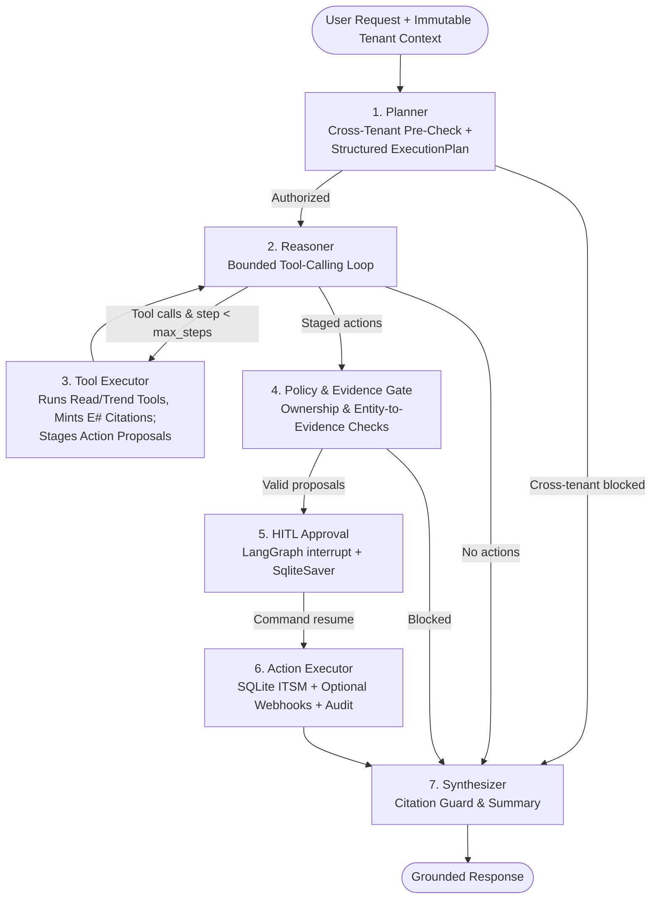

# Rayda Agentic AI Fleet Copilot

An Agentic AI Fleet Copilot built with **LangGraph**, **SQLite**, **Google Gemini** (provider-agnostic), **Streamlit**, and **Typer** that answers fleet telemetry questions with record-level citations, detects multi-day hardware and compliance trends, and proposes human-approved operational actions under strict tenant isolation.

---

## 1. Installation & Setup

**Prerequisites:** Python 3.11+ and [`uv`](https://docs.astral.sh/uv/) (or `pip`).

```bash
uv venv .venv
source .venv/bin/activate
uv pip install -e ".[dev]"

cp .env.example .env
# Set GOOGLE_API_KEY in .env (or switch LLM_PROVIDER to openai / anthropic)
```

On first launch, `data/device-telemetry-dataset.ndjson` is automatically ingested idempotently into `runtime/fleet_copilot.db`.

---

## 2. Running the Agent

### Streamlit Web UI (Primary)

```bash
.venv/bin/streamlit run src/fleet_copilot/interfaces/streamlit_app.py
```

Four workspace views are available from the left navigation rail:
- **Copilot:** Split-screen chat with persistent multi-turn threads, per-response **Sources & tools** inspector, live **Fleet Pulse** panel, and inline **Administrator Approval** cards when paused at LangGraph’s `interrupt()`.
- **Fleet Health:** Device inventory table with inline Disk/RAM progress bars, interactive device time-series charts, and categorized trend signals.
- **Operations & Audit:** Persisted operational actions (`ORD-*`, `TKT-*`, `RPL-*`, `NTF-*`) and filterable security/operations audit logs.
- **Live Ingestion:** Realtime snapshot simulator and batch `.ndjson`/`.json` uploader supporting unseen compliance checks and custom JSON fields with zero restart.

### CLI

```bash
.venv/bin/fleet-copilot companies
.venv/bin/fleet-copilot chat --tenant acme-001 --actor admin-alice
.venv/bin/fleet-copilot ingest data/device-telemetry-dataset.ndjson
.venv/bin/fleet-copilot actions --tenant acme-001
.venv/bin/fleet-copilot audit --tenant acme-001
```

---

## 3. Running Evaluations

```bash
# Tier 1: Unit, security, analytics, planner & LangGraph HITL tests (offline)
.venv/bin/pytest -v

# Tier 2 (Offline CI): 14-scenario dynamic ground-truth evaluation harness
.venv/bin/python -m evals.run_evals --mode deterministic

# Tier 2 (Live LLM): Same 14 scenarios against configured Gemini/OpenAI/Anthropic model
.venv/bin/python -m evals.run_evals --mode live

# Linting
.venv/bin/ruff check src tests evals
```

Eval scenarios compute ground-truth targets dynamically from the active database across 6 categories (`grounded_qa`, `anti_hallucination`, `trend_analysis`, `generalization`, `action_hitl`, `security_guardrails`) and write reports to `evals/reports/latest_report.{json,md}`.

> **Gemini Free-Tier Note:** `gemini-3.6-flash` has a 20 req/day free-tier limit; a billed API key (or `ENABLE_LLM_PLANNER=false` to cut LLM calls per turn) is recommended for full 14-scenario `--mode live` runs.

---

## 4. Agent Architecture

The copilot runs an explicit 7-node LangGraph `StateGraph` backed by `SqliteSaver` checkpoints:



- **Planning (`planner`):** Runs a deterministic cross-tenant check first, then uses `llm.with_structured_output(ExecutionPlan)` (with deterministic fallback) to generate a query-specific 2–5 step plan and suggested tool list.
- **Explicit Agent Loop (`reasoner` ↔ `tool_executor`):** Bounded by `max_agent_steps` (`8` by default). Action tools never mutate state directly; they stage `ActionProposal` objects.
- **Durable HITL (`hitl_approval`):** Pauses via LangGraph `interrupt()` + `SqliteSaver`, surviving page refreshes and restarts until explicit approval/rejection via `Command(resume=...)`.

---

## 5. Tool Catalog

All tools are bound by closure to `TenantTelemetryRepository(db, company_id)` — `company_id` is never an LLM argument.

### Query & Discovery Tools
| Tool | Purpose |
| --- | --- |
| `get_fleet_overview()` | Dynamically discovers tenant device/snapshot counts, OS distribution, observed compliance checks, and software. |
| `list_devices(os_name, device_type, employee_id)` | Lists latest device snapshots filtered by OS, form factor (`laptop`/`desktop`), or employee. |
| `get_device_telemetry(device_id, start_date, end_date, latest_only)` | Retrieves latest or multi-day telemetry history for one device. |
| `query_low_storage_devices(threshold_free_pct, as_of_latest, device_type)` | Finds devices below a configurable disk free percentage. |
| `query_compliance_failures(severity, check_id, as_of_latest, device_type)` | Queries compliance failures by severity, check ID, or form factor. |
| `query_os_versions(product_name, below_version, device_type)` | Semantic version filtering (e.g., `macOS` `< 15`). |
| `query_installed_software(software_name, as_of_latest)` | Searches installed applications across tenant devices. |
| `query_telemetry_sql(sql)` | Safe read-only SQL against tenant-isolated `v_*` views (including `json_extract(raw_payload, ...)` for unseen attributes). |

### Time-Series & Trend Tools
| Tool | Purpose |
| --- | --- |
| `detect_battery_degradation(...)` | Flags degraded battery conditions, high cycle counts, and declining `full_charge_capacity` (tolerates missing battery records). |
| `detect_ram_constraints(...)` | Identifies sustained high RAM utilization across snapshots. |
| `detect_storage_trends(...)` | Detects persistently low disk space and rapid daily depletion slopes with days-to-zero projections. |
| `detect_compliance_drift(...)` | Detects `pass -> fail` regressions over time on any compliance check. |
| `detect_software_anomalies(...)` | Statistically detects low-prevalence or post-baseline software without hardcoded blocklists. |
| `run_fleet_insights_report(...)` | Runs all trend detectors for broad fleet health reviews. |

### Guarded Action Tools (Policy Gate + Human Approval Required)
| Tool | Parameters | Record ID |
| --- | --- | --- |
| `create_upgrade_order` | `device_id, component, spec, rationale, evidence_ids` | `ORD-*` |
| `open_remediation_ticket` | `device_id, check_id, note, rationale, evidence_ids` | `TKT-*` |
| `flag_device_for_replacement` | `device_id, reason, rationale, evidence_ids` | `RPL-*` |
| `notify_employee` | `employee_id, message, rationale, evidence_ids` | `NTF-*` |

---

## 6. Grounding Strategy

- **Record-Level Traceability:** Every read/trend tool emits structured `Citation` objects keyed by `(device_id, collected_at)` or `(window_start, window_end)` and minted as canonical `E1`, `E2`, ... IDs in `evidence_store`.
- **Deterministic Citation Guard:** `synthesizer_node` cross-checks inline `[E#]` tags against `evidence_store` and strips any unverified/fabricated `[E#]` tag from the final response.
- **Zero-Result Fidelity:** Empty query results mint an explicit `0`-count citation so the agent reports zero matches accurately instead of fabricating issues or substituting other severities.
- **Deterministic Math:** Averages, slopes, version comparisons, and projections run in Python/SQL rather than the LLM.

---

## 7. Guardrails

1. **Three-Layer Tenant Isolation:**
   - *Planner Pre-Check:* Dynamically blocks explicit cross-company or foreign-entity requests before calling the LLM and logs `CROSS_TENANT_BLOCKED`.
   - *Closure-Bound Repository:* Every SQL query unconditionally scopes `WHERE company_id = ?` from runtime config.
   - *SQLite C-Level Authorizer:* `query_telemetry_sql` runs with `PRAGMA query_only = ON` over tenant-filtered `TEMP VIEW`s (`v_snapshots`, `v_disk_volumes`, `v_compliance_results`, `v_installed_software`, `v_network_interfaces`) and denies direct base-table reads, writes, DDL, `PRAGMA`, and `ATTACH`.
2. **Policy & Evidence Sufficiency Gate (`ActionPolicyValidator`):** Refuses proposals targeting foreign/unknown entities, missing or fabricated `evidence_ids`, or citations that do not match the target device/employee.
3. **Fail-Closed HITL (`interrupt()`):** Missing or omitted approval decisions default to `REJECTED`.
4. **Idempotency & Immutable Audit Log:** Approved actions are deduplicated per tenant via SHA-256 `idempotency_key` and persisted to SQLite (`executed_actions`) plus optional HMAC-SHA256 webhooks (`ACTION_WEBHOOK_URL` / `SLACK_WEBHOOK_URL`). All security and operational events write to SQLite `audit_logs` and append-only `runtime/audit_log.jsonl`.

---

## 8. Key Design Decisions & Trade-offs

- **Generalization over Static Dataset Rules:** Schema-tolerant Pydantic models (`extra="allow"`), `raw_payload` JSON retention, idempotent realtime upserts, dynamic company/check discovery, and tenant-isolated ad-hoc SQL ensure the agent handles evolving schemas without code changes.
- **Hybrid Structured Planner:** Combining a deterministic security pre-check with Pydantic structured LLM planning (`ExecutionPlan`) delivers task-specific planning while keeping tenant isolation deterministic and allowing `ENABLE_LLM_PLANNER=false` for low-latency/low-quota runs.
- **SQLite vs. DuckDB:** SQLite requires zero extra infrastructure, exposes C-level `set_authorizer` for safe ad-hoc SQL sandboxing, and natively backs LangGraph’s `SqliteSaver`. At large multi-tenant scale, the repository interface maps directly to Postgres with Row-Level Security (RLS).
- **Real Local Persistence + Pluggable Webhooks:** Approved actions perform real transactional mutations in SQLite (queryable and deduplicated) and dispatch real signed HTTP payloads when webhook env vars are configured.
- **LLM Failover:** Configured with `gemini-3.6-flash` and automatic fallback (`gemini-3.5-flash-lite`, `gemini-3.1-flash-lite`) to handle transient `503` provider spikes gracefully.
